# Building a Secure Two-Tier Web Application in Azure

Most business applications are split into tiers: a front end that users reach, and a back end, such as a database, that they should never reach directly. This lab builds that split in Azure with two virtual machines on one virtual network. The web server sits in a public subnet with a public address. The database server sits in a private subnet with no public address at all. Network security group rules decide who can talk to the database.

The business reason is simple. A database that cannot be reached from the internet removes the most common way company data ends up exposed. This lab shows how to build that, and how to check it.

You do not need any Azure experience to follow this. Each step says what it does, what to do, and what you should see when it works.

## What this lab is for

- **Build a network with two zones:** one virtual network, one public subnet, one private subnet.
- **Place a server in each zone:** a web server you can reach from the internet and a database server you cannot.
- **Reach a private server the right way:** connect to the web server first, then test the private one from inside the network.
- **Control traffic with firewall rules:** write network security group rules that allow only the web subnet to reach the database subnet.
- **Take it down and prove it:** delete the resource group and confirm nothing is left.

## Words you will see

| Word | What it means here |
|---|---|
| Tier | One layer of an application. Here there are two: the web tier and the database tier. |
| Virtual network (VNet) | A private network inside Azure. Resources on it can talk to each other by private address. |
| Subnet | A slice of a virtual network with its own range of addresses. |
| CIDR (Classless Inter-Domain Routing) range | A short way to write a block of addresses. `10.0.0.0/24` means the 256 addresses from `10.0.0.0` to `10.0.0.255`. |
| Public IP address | An address reachable from the internet. |
| Private IP address | An address that only works inside the virtual network. |
| Network security group (NSG) | A set of allow and deny rules for network traffic. Lower priority numbers are checked first. |
| SSH (Secure Shell) | A way to open a command line on a remote Linux server. |
| Key pair and `.pem` file | A matching pair of keys used instead of a password for SSH. Azure keeps the public half. You download the private half once, as a `.pem` file. |
| Jump host | A server you connect to first so you can reach servers that have no public address. Here, the web server. |
| Ping | A test that sends a small message to another machine and waits for a reply. |

## Architecture

```
   Internet
      |
      |  SSH (22) and HTTP (80) allowed
      v
+---------------------------------------------------------------+
|  Virtual network: vnet-lab02  (10.0.0.0/16)                   |
|                                                               |
|  +-------------------------------------------------------+    |
|  |  Public subnet: snet-web  (10.0.0.0/24)               |    |
|  |                                                       |    |
|  |    vm-web-01   public IP, private IP 10.0.0.4         |    |
|  +-------------------------------------------------------+    |
|                            |                                  |
|                            |  allowed: only from 10.0.0.0/24  |
|                            v                                  |
|  +-------------------------------------------------------+    |
|  |  Private subnet: snet-db  (10.0.1.0/24)               |    |
|  |                                                       |    |
|  |    vm-db-01   no public IP, private IP 10.0.1.4       |    |
|  +-------------------------------------------------------+    |
+---------------------------------------------------------------+
```

## Lab variables

| Item | Value |
|---|---|
| Resource group | `rg-lab02-<yourname>` |
| Virtual network | `vnet-lab02`, address space `10.0.0.0/16` |
| Public subnet | `snet-web`, `10.0.0.0/24` |
| Private subnet | `snet-db`, `10.0.1.0/24` |
| Web server | `vm-web-01` |
| Database server | `vm-db-01` |
| Key pair | `vm-web-01_key`, the name the portal suggests |
| Image | Ubuntu Server 24.04 LTS, x64 |
| Size | A small size with 2 vCPUs. This lab used `Standard_D2s_v3`. |
| Region | Central US. Any region works if every resource uses the same one. |

## What's inside

```
azure-2-tier-web-lab/
  README.md      this file
  .gitignore     keeps private keys out of Git
  images/        screenshots from the lab, with public IP addresses blacked out
```

## Before you start

- An Azure subscription and permission to create resources in it.
- The Azure CLI installed, to run the checks.
- A terminal with an SSH client. Windows 10 and 11 include one.

Sign in first, and do it again in any new terminal:

```powershell
az login
```

## Use your own name, not mine

Wherever you see `<yourname>`, replace it with your own name or a short handle, and leave out the angle brackets. If you type `<yourname>` into a terminal as it is, PowerShell reads the `<` as a file redirect and fails with "The system cannot find the file specified." The screenshots in this repository show my name in the resource group, `rg-lab02-demarcus`. Use your own name or a short handle for yours, so you can tell your resources from anyone else's and they match your own screenshots. A resource group name can include capital letters and hyphens.

Never commit the `.pem` private key to Git, and never paste it into a document. Whoever holds that file can sign in to the web server. The `.gitignore` in this repository blocks `.pem` files for that reason.

## Step 1: Build the virtual network

**What this step does.** It creates the network and its two subnets before any server exists, so each server has a place to go.

**What to do.** In the portal, search for **Virtual networks**, click **Create**, and use:

- Resource group: create new, `rg-lab02-<yourname>`
- Name: `vnet-lab02`
- Region: Central US
- IP address space: `10.0.0.0/16`
- Subnet 1: name `snet-web`, range `10.0.0.0/24`
- Subnet 2: name `snet-db`, range `10.0.1.0/24`

Read the range column on the IP addresses tab before you continue. When you add or rename a subnet, the portal suggests its own range. This README uses `10.0.0.0/24` for `snet-web` and `10.0.1.0/24` for `snet-db`, the ranges this lab was built with. If your screen shows different ranges, write them down. Use yours wherever this README shows those two ranges, and work out the two servers' private addresses from them: the first server in a subnet gets the subnet's `.4` address.

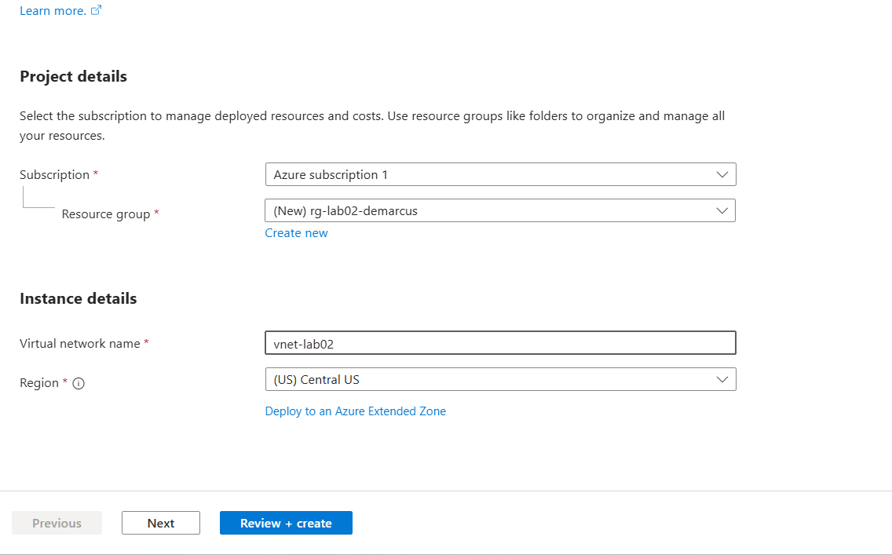

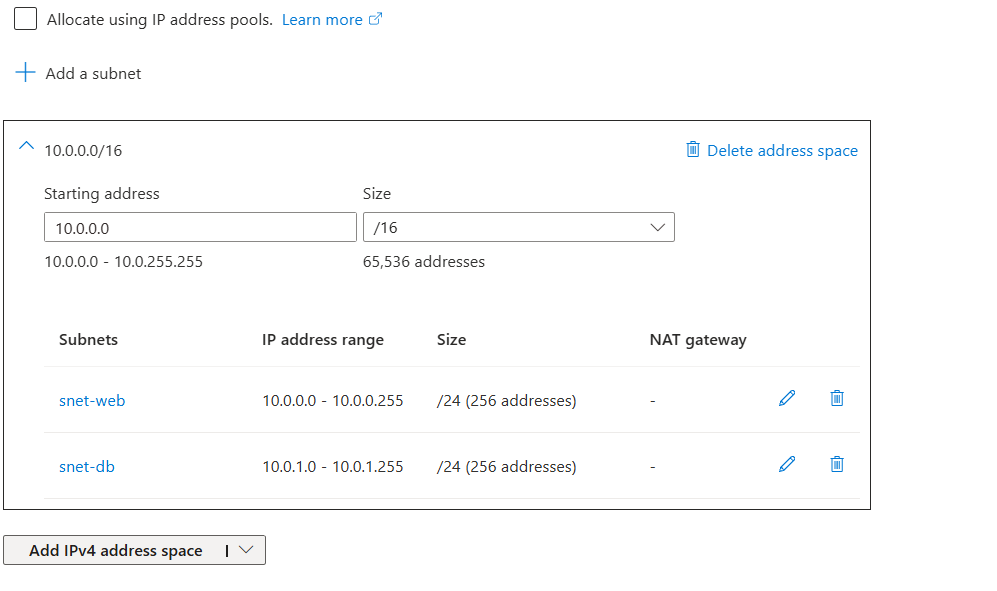

Click **Review + create**, then **Create**.

**What you should see.** Check the real settings from Azure and not from the form:

```powershell
az network vnet subnet list -g rg-lab02-<yourname> --vnet-name vnet-lab02 -o table
```

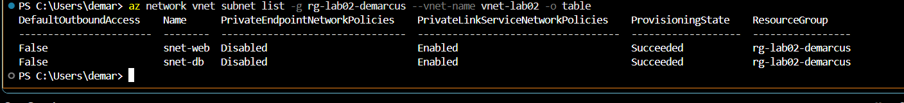

The table lists `snet-web` and `snet-db` with a provisioning state of `Succeeded`. It does not show the address ranges, so check each range on its own:

```powershell
az network vnet subnet show -g rg-lab02-<yourname> --vnet-name vnet-lab02 -n snet-web --query addressPrefixes -o tsv
az network vnet subnet show -g rg-lab02-<yourname> --vnet-name vnet-lab02 -n snet-db --query addressPrefixes -o tsv
```

The first should print `10.0.0.0/24` and the second `10.0.1.0/24`.

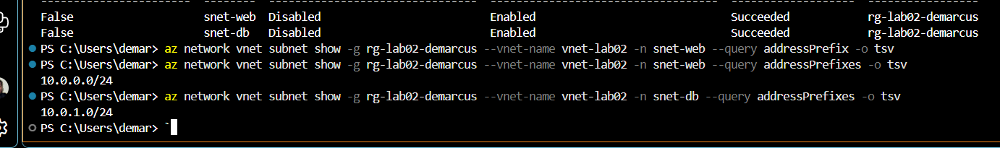

## Step 2: Deploy the web server

**What this step does.** It creates the server the public will reach.

**Before you run it.** This server gets a public IP address and the database server will not. What do you expect that difference to change when you try to connect to each one from your home computer?

**What to do.** In the portal, search for **Virtual machines**, click **Create**, and use:

- Resource group: `rg-lab02-<yourname>`
- Name: `vm-web-01`
- Region: Central US
- Image: Ubuntu Server 24.04 LTS, VM architecture **x64**. If it is not offered, pick the closest Ubuntu Server LTS.
- Size: `Standard_D2s_v3`, or any similar size your region offers. The small `Standard_B1s` size that guides often suggest was not available in Central US when this lab was built, and sizes differ by region and subscription. Pick any size the portal lists, and use the same one for both servers.
- Authentication: SSH public key, username `azureuser`, key pair name `vm-web-01_key` (the portal fills this in from the server name; keep it)
- Public inbound ports: allow selected ports, **HTTP (80)** and **SSH (22)**
- On the Networking tab: virtual network `vnet-lab02`, subnet `snet-web`, public IP create new (Standard), NIC network security group **Basic**

Click **Review + create**, then **Create**. When Azure offers the private key, click **Download private key and create resource**. The file is named after the key pair, `vm-web-01_key.pem`. Keep it somewhere safe and outside this repository. Azure shows it once.

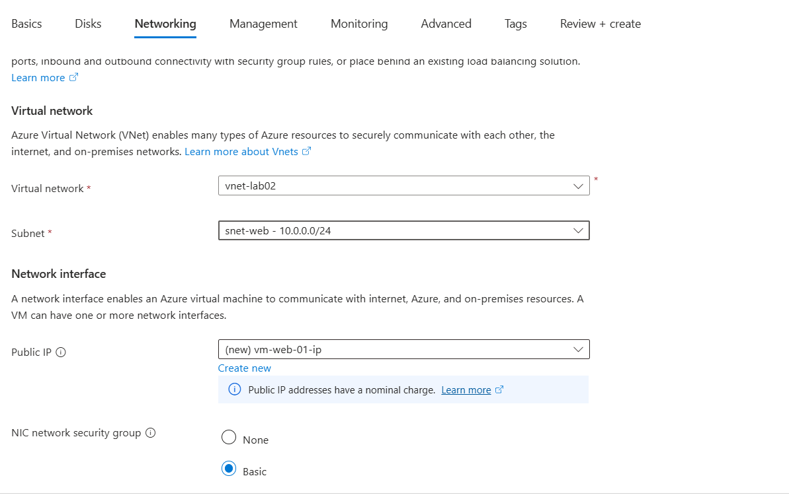

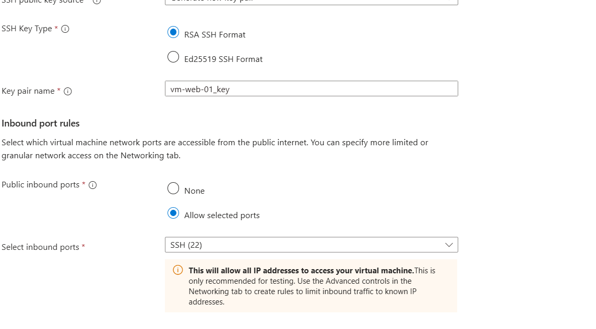

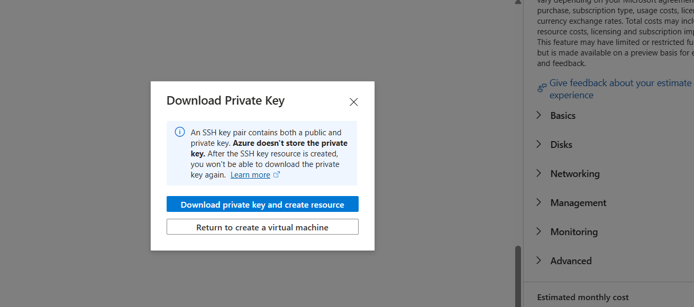

**What you should see.** The deployment finishes and `vm-web-01` shows a public IP address. Check it from Azure:

```powershell
az vm list -g rg-lab02-<yourname> -d -o table
```

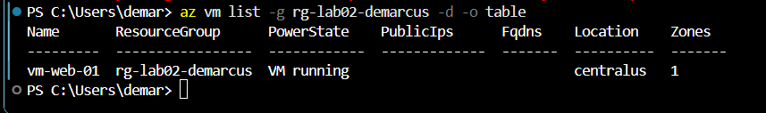

The public IP address is blacked out in the screenshot. Then list the firewall rules Azure created for it:

```powershell
az network nsg rule list -g rg-lab02-<yourname> --nsg-name vm-web-01-nsg -o table
```

It lists two rules, `SSH` for port 22 and `Allow-HTTP` for port 80, both allowing TCP from any source. If the HTTP rule is missing, the ports dropdown only had SSH selected. Open the network security group in the portal, choose **Inbound security rules**, click **Add**, set the service to HTTP, and give it any unused priority.

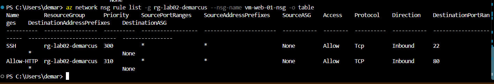

This list shows only the rules you or the portal created. The built-in default rules, such as `AllowVnetInBound` at priority 65000 and `DenyAllInBound` at 65500, show up in the portal under **Inbound security rules**.

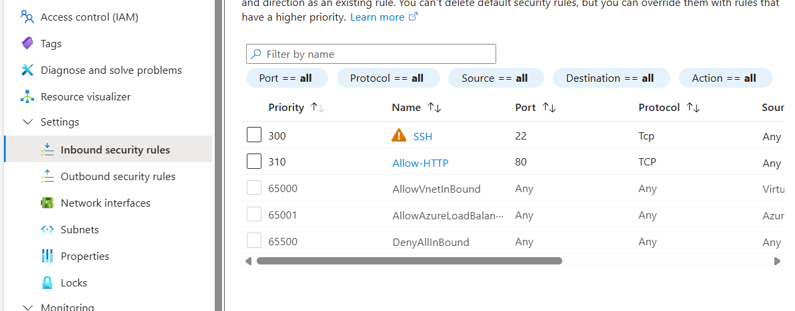

## Step 3: Deploy the database server

**What this step does.** It creates the server that must stay private.

**What to do.** Create another virtual machine and use:

- Resource group: `rg-lab02-<yourname>`
- Name: `vm-db-01`
- Region: Central US
- Image: Ubuntu Server 24.04 LTS, VM architecture **x64**
- Size: `Standard_D2s_v3`, or any similar size your region offers
- Authentication: SSH public key, username `azureuser`, use the existing key stored in Azure, `vm-web-01_key`
- Public inbound ports: allow selected ports, **SSH (22)**
- On the Networking tab: virtual network `vnet-lab02`, subnet **`snet-db`**, public IP **None**, NIC network security group **Basic**

The subnet and the public IP choices are the two settings this lab depends on. Keep the network security group on Basic as well. That creates the group you edit in Steps 6 and 7. With None selected there is nothing to edit. Click **Review + create**, then **Create**.

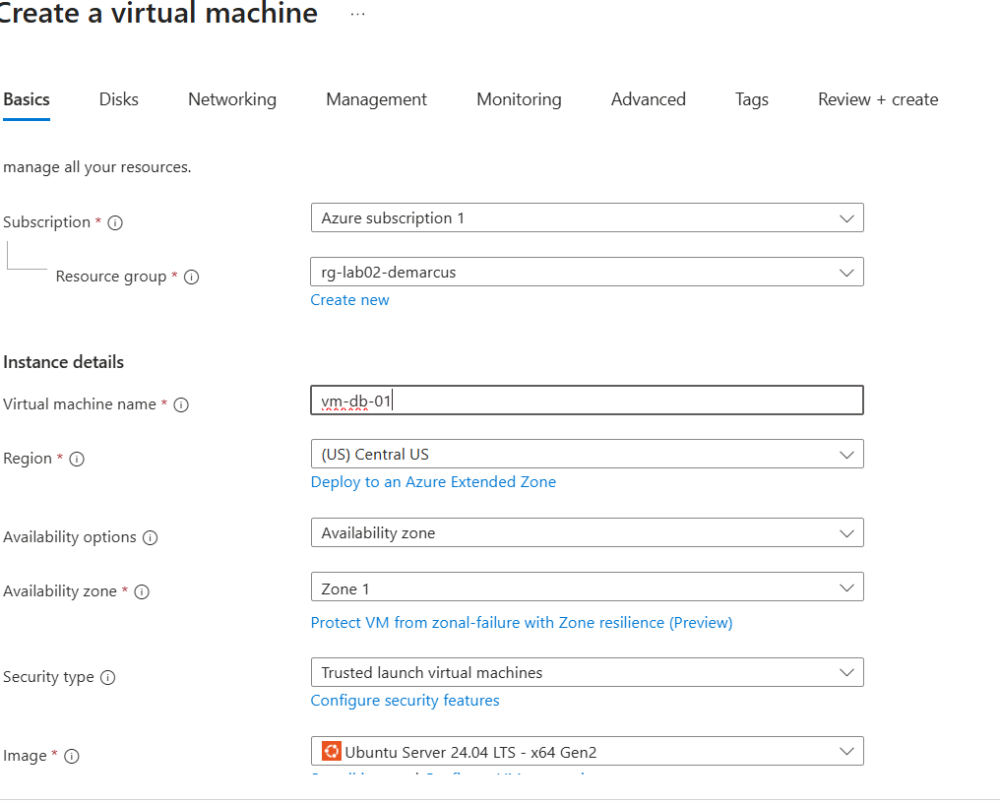

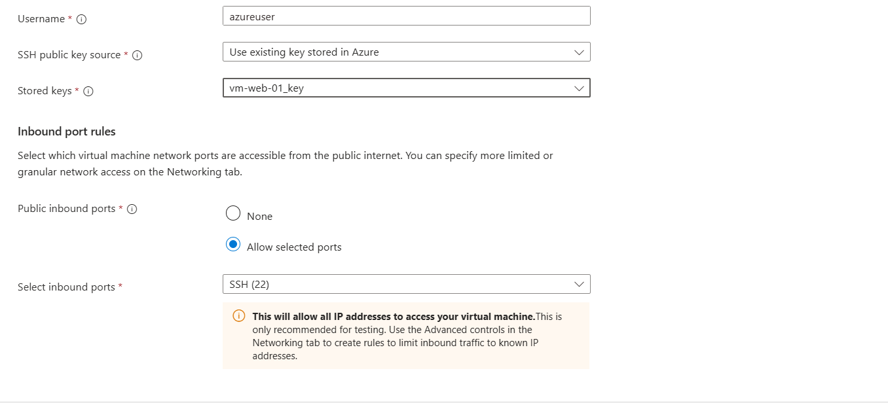

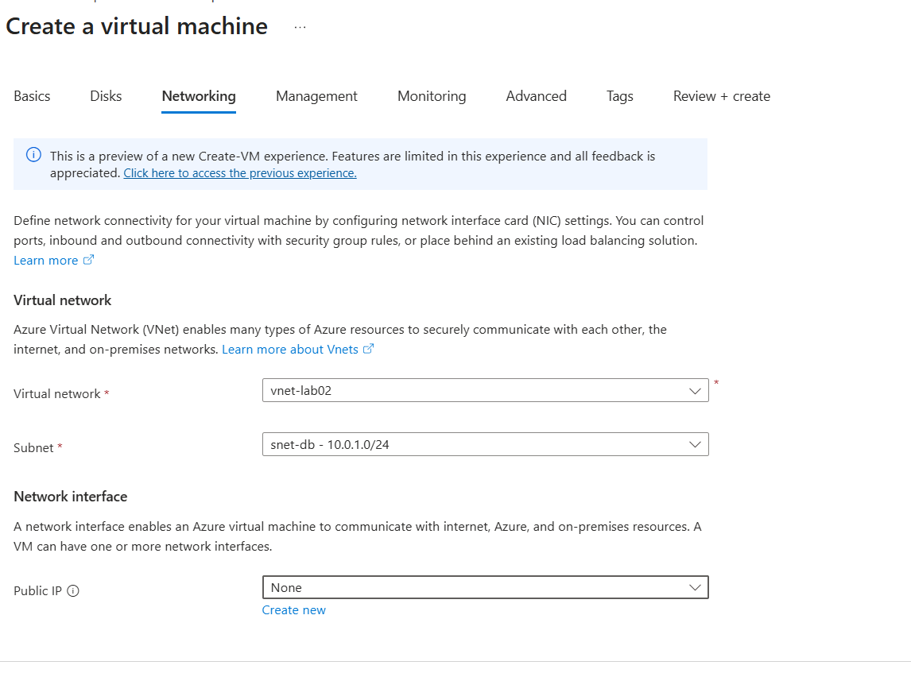

**What you should see.** Check both servers from Azure:

```powershell
az vm list -g rg-lab02-<yourname> -d -o table
```

`vm-web-01` has a public IP. `vm-db-01` has none.

## Step 4: Find the database server's private address

**What this step does.** It tells you where to aim the test in the next step.

**What to do.** In the portal, open `vm-db-01` and find **Private IP address**. You can also run:

```powershell
az vm list-ip-addresses -g rg-lab02-<yourname> -o table
```

**What you should see.** The database server's private address is `10.0.1.4`. Azure keeps the first four addresses of every subnet for its own use, so `.4` is the first one a server can get.

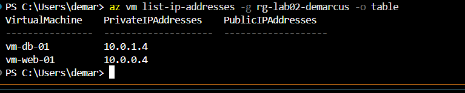

## Step 5: Connect to the web server and ping the database server

**What this step does.** It proves the two servers can reach each other inside the virtual network, even though you cannot reach the database server from outside.

**What to do.** Connect to the web server from your computer, using its public IP and the real path to your key file. Check the file name and date in your Downloads folder first. If a key with the same name was already there, Windows adds ` (1)` to one of them, and an old key from an earlier server will not work on this one. A path with spaces or parentheses needs double quotes:

```powershell
ssh -i "<path-to-key>\vm-web-01_key.pem" azureuser@<web-public-ip>
```

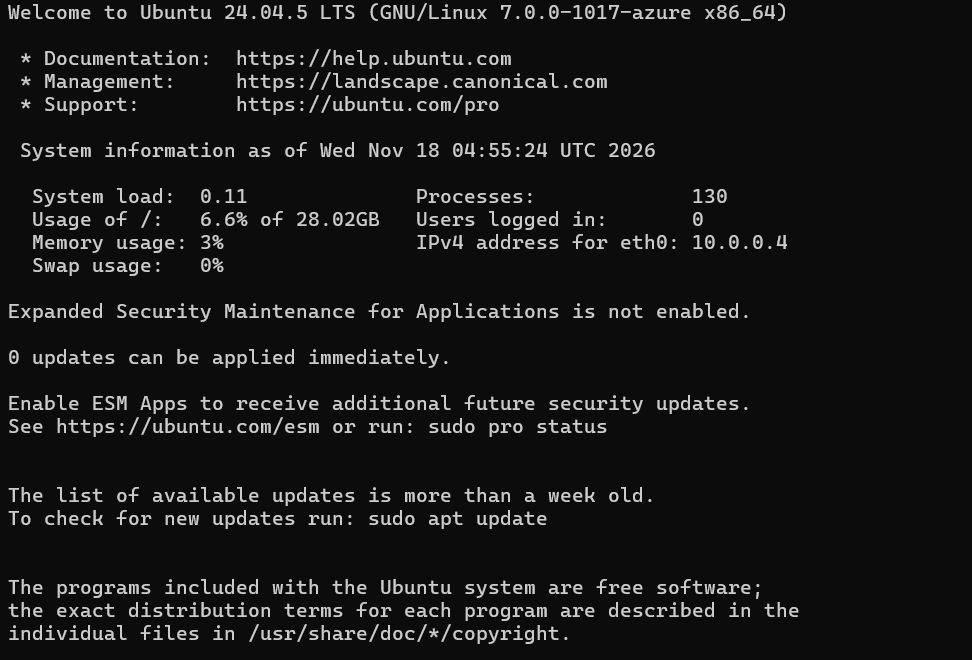

Keep this window for commands that run on the server, such as the ping below. Run every `az` command in a second terminal window on your own computer. The server does not have the Azure CLI installed, so `az` there fails with "command not found".

The first time, SSH asks whether to trust the server. Type `yes`. Then, from inside the web server, ping the database server four times:

```bash
ping -c 4 10.0.1.4
```

**What you should see.** Four replies from `10.0.1.4`, each taking about a millisecond, with `0% packet loss` in the summary. Nothing you have added to the database server's firewall group allows this ping yet. It gets through because of the built-in `AllowVnetInBound` rule, which Step 6 explains. You cannot SSH straight to the database server from your own computer, because it has no public IP. Reaching it means going through the web server first, which is why the web server is called a jump host here.

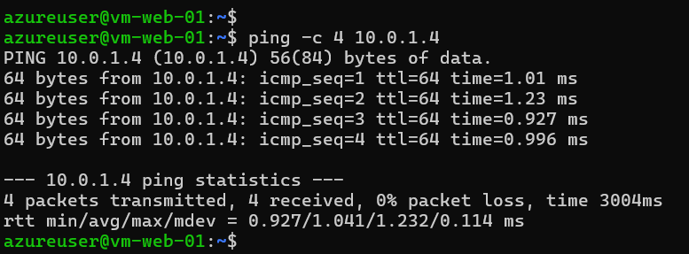

## Step 6: Allow the web subnet to reach the database server

**What this step does.** It writes down, as a firewall rule, who is meant to talk to the database server.

**What to do.** In the portal, open `vm-db-01`, open **Networking**, and select its network security group. Open **Inbound security rules**, click **Add**, and use:

- Source: IP Addresses
- Source IP addresses/CIDR ranges: `10.0.0.0/24`
- Source port ranges: `*`
- Destination: Any
- Service: Custom
- Destination port ranges: `*`
- Protocol: Any
- Action: Allow
- Priority: `100`
- Name: `Allow-Web-Subnet`

Check the **Destination port ranges** box before you click **Add**. With Service set to Custom, the portal can show `8080` in it. Replace that with `*`. A rule that allows only port 8080 does not cover ping or SSH, and in Step 8 the web server would lose its ping once the deny rule from Step 7 is in place.

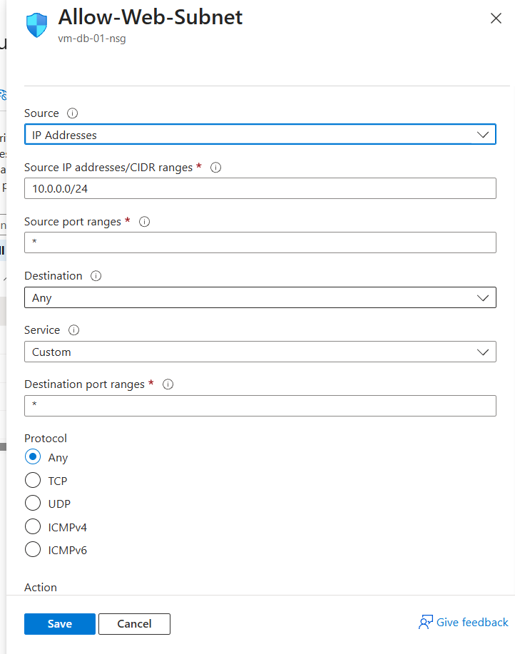

Click **Add**.

**What you should see.** `Allow-Web-Subnet` appears in the list with priority `100` and **Any** in the Port column. Check the port from Azure too, with the name of the group you opened in the portal:

```powershell
az network nsg rule show -g rg-lab02-<yourname> --nsg-name <db-nsg-name> -n Allow-Web-Subnet --query destinationPortRange -o tsv
```

It prints `*`.

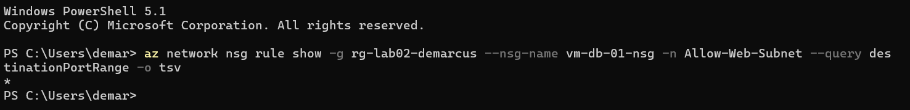

**Read this before you move on.** This rule on its own does not lock anything. Every network security group also has built-in default rules. One of them, `AllowVnetInBound` at priority 65000, already allows traffic from any address inside the virtual network. So the database server already accepts traffic from the web subnet, and from any other subnet you add later. Step 7 closes that gap.

## Step 7: Block everything else inside the network

**What this step does.** It makes the database server accept traffic from the web subnet only. Rules are checked from the lowest priority number up, and the first match wins.

**What to do.** In the same network security group, click **Add** under **Inbound security rules** and use:

- Source: Service Tag
- Source service tag: `VirtualNetwork`
- Source port ranges: `*`
- Destination: Any
- Service: Custom
- Destination port ranges: `*` (replace `8080` if the portal shows it)
- Protocol: Any
- Action: **Deny**
- Priority: `200`
- Name: `Deny-Other-VNet`

Click **Add**.

**What you should see.** The rules list has `Allow-Web-Subnet` at 100 before `Deny-Other-VNet` at 200. Traffic from `10.0.0.0/24` matches the allow rule first. Traffic from any other address in the virtual network matches the deny rule before the default rule at 65000 can allow it. List the rules from Azure with the name of the group you opened in the portal:

```powershell
az network nsg rule list -g rg-lab02-<yourname> --nsg-name <db-nsg-name> -o table
```

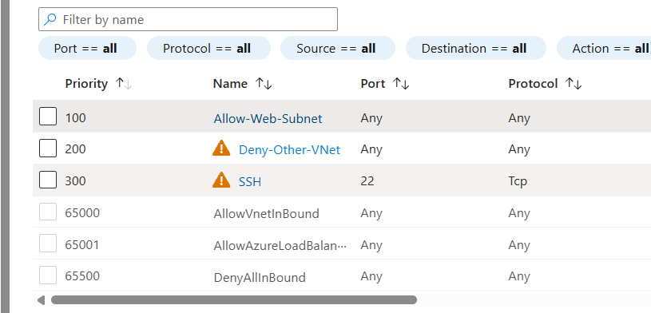

The portal marks `Deny-Other-VNet` with a warning icon. Open the rule and it shows two messages. One says the rule denies virtual network access, which is its purpose. The other says it may deny traffic from `AzureLoadBalancer`, which carries the health checks of an Azure load balancer. This lab has no load balancer, so that message does not apply here. On a server behind one, the portal's advice is to add an allow rule with a higher priority for it.

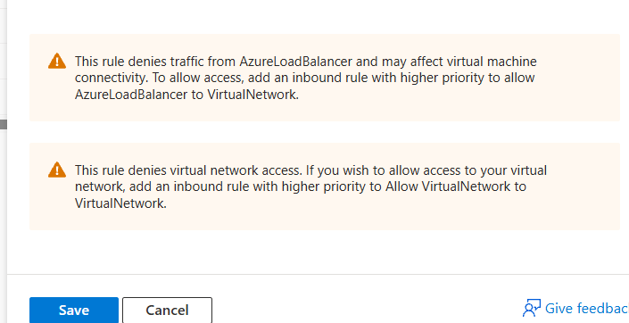

## Step 8: Check that the web server can still reach the database server

**What this step does.** It checks that the deny rule did not cut off the traffic you meant to allow.

**What to do.** Connect to the web server again and repeat the ping:

```bash
ping -c 4 10.0.1.4
```

**What you should see.** Four replies again. The allow rule at priority 100 matches before the deny rule at 200, so the web server still gets through.

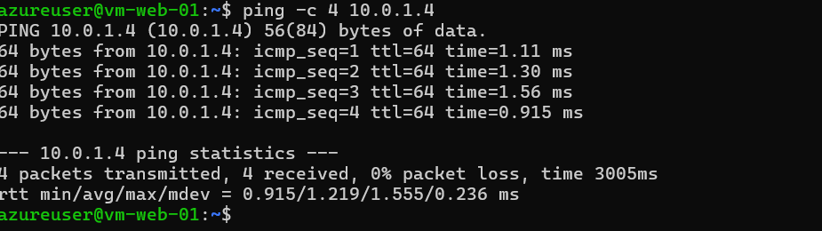

## Step 9: Tear it down

**What this step does.** It removes everything the lab created. Deleting the resource group deletes both servers, their disks, the network and the rules. There is no undo. The two virtual machines bill while they exist. A lab this size costs cents for an hour, so delete the resource group when you finish and the bill stays small.

**What to do.** In the portal, open **Resource groups**, open `rg-lab02-<yourname>`, click **Delete resource group**, type the name to confirm, and click **Delete**. Wait for the notification. Then check from the terminal:

```powershell
az login
az group exists -n rg-lab02-<yourname>
```

**What you should see.** `az group exists` prints `false`. Delete the `.pem` file from your computer too, since the server it opened no longer exists.

## Troubleshooting

| Problem | What to check |
|---|---|
| Ping fails | Confirm `vm-db-01` is in `snet-db` and both servers are in `vnet-lab02`. If it started after Step 7, confirm the allow rule has a lower priority number than the deny rule. |
| SSH says `Permission denied (publickey)` | The server answered, so the network and firewall are fine. The server rejected the key you offered. Check that you are using the key file downloaded for this server. If you have two files with similar names, try the other one. |
| I cannot SSH to `vm-db-01` from my computer | This is expected. It has no public IP. Connect to `vm-web-01` first. |

## What this lab does not do

- It does not lock down SSH on the web server. The portal warns that choosing SSH (22) allows every IP address to try it, and says that is only recommended for testing. Outside a lab, limit port 22 to your own address in the network security group.
- It does not install a web server or a database. The servers only prove the network layout, so nothing here serves a web page.
- It does not test a machine outside the web subnet being blocked. That needs a third machine in another subnet.
- It does not open an SSH session from the web server to the database server. That needs the key on the web server or an agent to carry it, and copying a private key onto a server is a bad habit.
